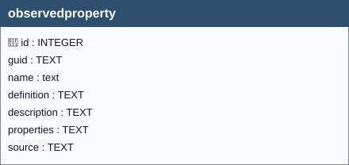

# Observed Property

## Definition

> *An ObservedProperty is a property of a Feature that is being observed by a Sensor, such as temperature, humidity, population count or color. It should be uniquely identified by its definition, which should point to an external vocabulary by means of a URL, URI or DID.* [^1]

> [^1]: Hylke van der Schaaf — **Open Geospatial Consortium (OGC)**,  
> **SensorThings API 2.0 (23-019)** *(DRAFT)*,  
> version 23-019.  
> https://hylkevds.github.io/23-019/23-019.html

&nbsp;

  
 <!--
  <strong>TABELLA SOILSITE EXP</strong> 
   Lorem Ipsum.
 -->

 

&nbsp;

## Table: `observedproperty`

### Columns

| Name | Type | Constraints | Description |
|------|------|-------------|-------------|
| `id` | `INTEGER` | PRIMARY KEY | A unique, read-only attribute that serves as an identifier for the entity. |
| `guid` | `TEXT` | UNIQUE | URI identifying the ObservedProperty. |
| `name` | `TEXT` | NOT NULL | A property provides a label for ObservedProperty entity, commonly a descriptive name. |
| `definition` | `TEXT` | NOT NULL | The URI of the ObservedProperty. Dereferencing this URI SHOULD result in a representation of the definition of the ObservedProperty. The definition SHOULD be unique in a service. |
| `description` | `TEXT` |  | A description about the ObservedProperty. |
| `properties` | `TEXT` |  | mime type: 'application/json'. A JSON Object containing user-annotated properties as key-value pairs. |
| `source` | `TEXT` | NOT NULL, DEFAULT 'Local' | Indicate the origin of the data. In the case of the insertion of new properties by the user, these will be marked with the label «Local». |

### Table Identifiers
In this table, the primary key is the *id* field (integer, auto-incrementing).  
There is also a text field named **GUID**, which stores a *UUID* (Universally Unique Identifier) compliant with RFC 4122.

Any foreign keys (FK) from other tables reference this table’s GUID field rather than the id field, ensuring stable and interoperable references across datasets and database instances.

> [!NOTE]
> The **guid` field** is the stable URI used to identify the ObservedProperty and is not generated automatically. It must be supplied when the record is created.

### Relationships (as child)
- None

### Referenced by (as parent)
- `datastream.guid_observedproperty` → `observedproperty.guid` (**ON UPDATE** CASCADE, **ON DELETE** CASCADE)
- `obsprocedure_obsdproperty.guid_observedproperty` → `observedproperty.guid` (**ON UPDATE** CASCADE, **ON DELETE** RESTRICT)

### Indexes
- None

### Triggers
- None

