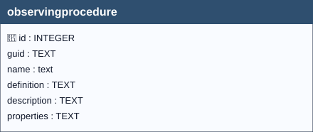

# Observing Procedure

## Definition

> *An **Observing Procedure** describes the method, process, or operational setup used to produce an observation. It defines *how* an observation is carried out. By providing explicit information on the observation method, the observing procedure ensures traceability, interpretability, and interoperability of observation results.*

&nbsp;

  
 <!--
  <strong>TABELLA SOILSITE EXP</strong> 
   Lorem Ipsum.
 -->

 

&nbsp;

## Table: `observingprocedure`

### Columns

| Name | Type | Constraints | Description |
|------|------|-------------|-------------|
| `id` | `INTEGER` | PRIMARY KEY | A unique, read-only attribute that serves as an identifier for the entity. |
| `guid` | `TEXT` | NOT NULL, UNIQUE | URI identifying the Observing Procedure. |
| `name` | `TEXT` | NOT NULL | A property provides a label for Observing Procedure entity, commonly a descriptive name. |
| `definition` | `TEXT` |  | The URI linking the Thing to an external definition. Dereferencing this URI SHOULD result in a representation of the definition of the Observing Procedure. |
| `description` | `TEXT` |  | This is a short description of the corresponding Observing Procedure entity. |
| `properties` | `TEXT` |  | mime type: 'application/json'. A JSON Object containing user-annotated properties as key-value pairs. |

### Table Identifiers
In this table, the primary key is the *id* field (integer, auto-incrementing).  
There is also a text field named **GUID**, which stores a *UUID* (Universally Unique Identifier) compliant with RFC 4122.

Any foreign keys (FK) from other tables reference this table’s GUID field rather than the id field, ensuring stable and interoperable references across datasets and database instances.

> [!NOTE]
> The **guid` field** is the stable URI used to identify the ObservedProperty and is not generated automatically. It must be supplied when the record is created.

### Relationships (as child)
- None

### Referenced by (as parent)
- `datastream.guid_observingprocedure` → `observingprocedure.guid` (**ON UPDATE** CASCADE, **ON DELETE** SET NULL)
- `obsprocedure_obsdproperty.guid_observingprocedure` → `observingprocedure.guid` (**ON UPDATE** CASCADE, **ON DELETE** CASCADE)
- `obsprocedure_sensor.guid_observingprocedure` → `observingprocedure.guid` (**ON UPDATE** CASCADE, **ON DELETE** CASCADE)

### Indexes
- None

### Triggers
- None

---

