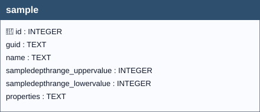

# Sample

## Definition

> *A Sample describes a material specimen obtained through a Sampling event. A Sample may also be used as the Feature of Interest of a Datastream.*

<p>
  
</p>


## Table: `sample`

### Columns
| Name | Type | Constraints | Description |
|---|---|---|---|
| `id` | `INTEGER` | PRIMARY KEY | A unique, read-only attribute that serves as an identifier for the entity. |
| `guid` | `TEXT` | UNIQUE | Universally unique identifier. |
| `name` | `TEXT` |  | A descriptive name for the Sample entity. |
| `sampledepthrange_uppervalue` | `INTEGER` |  | Upper depth of the sample measured from the surface, in centimetres. |
| `sampledepthrange_lowervalue` | `INTEGER` |  | Lower depth of the sample measured from the surface, in centimetres. |
| `properties` | `TEXT` |  | mime type: 'application/json'. A JSON Object containing user-annotated properties as key-value pairs. |

### Table Identifiers
In this table, the primary key is the *id* field (integer, auto-incrementing). There is also a text field named **GUID**, which stores a UUID. If GUID is missing or empty, it is generated automatically; later changes are prevented by dedicated triggers.

### Relationships (as child)
- None

### Referenced by (as parent)
- `sampling.guid_sample` → `sample.guid` (**ON UPDATE** CASCADE, **ON DELETE** CASCADE)
- `datastream.guid_sample` → `sample.guid` (**ON UPDATE** CASCADE, **ON DELETE** CASCADE)

### Indexes
- None

### Triggers
#### `sampleguid` / `sampleguidupdate`
**When they run:** AFTER INSERT / AFTER UPDATE OF `guid`  
**What they do:** Assign GUID at insert when missing; prevent changes later.  
**If the check passes:** Insert writes GUID; unchanged updates proceed.  
**If the check fails:** On change, abort with: `Cannot update guid column.`

#### Sample depth range checks
**When they run:** BEFORE INSERT / BEFORE UPDATE  
**What they do:** When both values are provided, require `sampledepthrange_uppervalue < sampledepthrange_lowervalue`.  
**If the check passes:** Statement proceeds.  
**If the check fails:** The statement is aborted with the corresponding depth range error.
```
