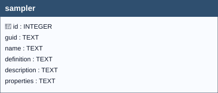

# Sampler

## Definition

> *A Sampler describes the device, tool, organisation or agent used to obtain a Sample.*

<p>&nbsp;</p>
<p>
  
</p>
<br clear="all">
<p>&nbsp;</p>

## Table: `sampler`

### Columns
| Name | Type | Constraints | Description |
|---|---|---|---|
| `id` | `INTEGER` | PRIMARY KEY | A unique, read-only attribute that serves as an identifier for the entity. |
| `guid` | `TEXT` | UNIQUE | Universally unique identifier. |
| `name` | `TEXT` | NOT NULL | A descriptive name for the Sampler entity. |
| `definition` | `TEXT` |  | The URI linking the Sampler to an external definition. |
| `description` | `TEXT` |  | A description of the Sampler entity. |
| `properties` | `TEXT` |  | mime type: 'application/json'. A JSON Object containing user-annotated properties as key-value pairs. |

### Table Identifiers
In this table, the primary key is the *id* field (integer, auto-incrementing). There is also a text field named **GUID**, which stores a UUID. If GUID is missing or empty, it is generated automatically; later changes are prevented by dedicated triggers.

### Relationships (as child)
- None

### Referenced by (as parent)
- `sampling.guid_sampler` → `sampler.guid` (**ON UPDATE** CASCADE, **ON DELETE** CASCADE)

### Indexes
- None

### Triggers
#### `samplerguid` / `samplerguidupdate`
**When they run:** AFTER INSERT / AFTER UPDATE OF `guid`  
**What they do:** Assign GUID at insert when missing; prevent changes later.  
**If the check passes:** Insert writes GUID; unchanged updates proceed.  
**If the check fails:** On change, abort with: `Cannot update guid column.`
```
