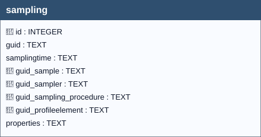

# Sampling

## Definition

> *A Sampling record describes the event through which a Sample was obtained, including the sampling time, location or ProfileElement, Sampler and Sampling Procedure.*

<p>&nbsp;</p>
<p>
  
</p>
<br clear="all">
<p>&nbsp;</p>

## Table: `sampling`

### Columns
| Name | Type | Constraints | Description |
|---|---|---|---|
| `id` | `INTEGER` | PRIMARY KEY | A unique, read-only attribute that serves as an identifier for the entity. |
| `guid` | `TEXT` | UNIQUE | Universally unique identifier. |
| `samplingtime` | `DATETIME` | NOT NULL, DEFAULT current UTC time | The time at which sampling was performed. |
| `locatedon` | `TEXT` |  | Foreign key to the SoilPlot table, guid field. |
| `guid_sample` | `TEXT` | NOT NULL | Foreign key to the Sample table, guid field. |
| `guid_sampler` | `TEXT` |  | Foreign key to the Sampler table, guid field. |
| `guid_sampling_procedure` | `TEXT` |  | Foreign key to the Sampling Procedure table, guid field. |
| `guid_profileelement` | `TEXT` |  | Foreign key to the ProfileElement table, guid field. |
| `properties` | `TEXT` |  | mime type: 'application/json'. A JSON Object containing user-annotated properties as key-value pairs. |

### Table Identifiers
In this table, the primary key is the *id* field (integer, auto-incrementing). There is also a text field named **GUID**, which stores a UUID. If GUID is missing or empty, it is generated automatically; later changes are prevented by dedicated triggers.

### Relationships (as child)
- `sampling.locatedon` → `soilplot.guid` (**ON UPDATE** CASCADE, **ON DELETE** CASCADE)
- `sampling.guid_sample` → `sample.guid` (**ON UPDATE** CASCADE, **ON DELETE** CASCADE)
- `sampling.guid_sampler` → `sampler.guid` (**ON UPDATE** CASCADE, **ON DELETE** CASCADE)
- `sampling.guid_sampling_procedure` → `sampling_procedure.guid` (**ON UPDATE** CASCADE, **ON DELETE** CASCADE)
- `sampling.guid_profileelement` → `profileelement.guid` (**ON UPDATE** CASCADE, **ON DELETE** CASCADE)

### Referenced by (as parent)
- None

### Indexes
- Index on `locatedon`.
- Index on `guid_sample`.
- Index on `guid_sampler`.
- Index on `guid_sampling_procedure`.
- Index on `guid_profileelement`.

### Triggers
#### `samplingguid` / `samplingguidupdate`
**When they run:** AFTER INSERT / AFTER UPDATE OF `guid`  
**What they do:** Assign GUID at insert when missing; prevent changes later.

#### Sampling location controls
**When they run:** BEFORE INSERT / BEFORE UPDATE  
**What they do:** Require exactly one of `locatedon` and `guid_profileelement`. A linked SoilPlot must be of type `sample`; a linked ProfileElement must belong to an observed SoilProfile.  
**If the check passes:** Statement proceeds.  
**If the check fails:** The statement is aborted with the corresponding location or profile type error.
```
